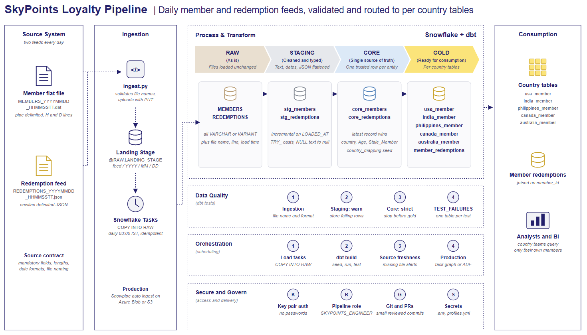

# SkyPoints Loyalty Pipeline

ELT pipeline for the SkyPoints airline loyalty program, built with **Snowflake** and **dbt**.
It loads two daily feeds (member profiles and partner redemptions), validates them against the
source contract, keeps one trusted record per member, and splits members into per country tables.

## Problem

All SkyPoints members (millions) sit in one database. The business wants them split by country into
separate tables. A Source System sends two feeds every day:

1. **Member flat file**: pipe delimited, an `|H|` header line followed by `|D|` member lines.
2. **Redemption feed**: JSON from partner airlines, one member object with a nested `redemptions` array.

The pipeline must assume billions of records per day.

## Architecture



| Layer | Built by | Purpose |
|---|---|---|
| Landing stage | `ingest/ingest.py` | Files as delivered, in folders by feed and date |
| RAW | Snowflake Tasks (`COPY INTO`) | Every source column as VARCHAR (JSON as VARIANT), plus file name, line number and load time |
| STAGING | dbt, incremental on `LOADED_AT` | Member lines only, trimmed text, `NULL` text to null, typed dates and numbers, JSON flattened |
| REFERENCE | dbt seed | `country_mapping`: source codes (AU, PHIL) to ISO codes and target tables |
| CORE | dbt | Single source of truth: valid rows only, one row per member and per transaction, Age and Stale_Member |
| GOLD | dbt | Per country member tables and redemptions joined to members |
| TEST_FAILURES | dbt tests | Rows that failed validation, one table per test |

## Repository structure

```
data/                     sample feeds for two days (members, redemptions) and reference samples
snowflake/01_setup/       role and database, file formats, landing stage, raw tables
snowflake/02_task/        scheduled tasks that load the stage into RAW
ingest/ingest.py          simulates the Source System file drop (validates names, uploads to the stage)
dbt/                      dbt project skypoints_transformations
  macros/                 schema naming, string cleaning, file timestamp, country members
  seeds/                  country_mapping
  models/01_staging/      stg_members, stg_redemptions, sources and tests
  models/02_core/         core_members, core_redemptions and tests
  models/03_gold/         country tables, member_redemptions and tests
  tests/generic/          max_length, non_negative
docs/                     Snowflake key pair setup
```

## How to run

**Prerequisites:** Snowflake account, Python 3.12, Git.

1. **Authentication:** create a key pair and attach it to your Snowflake user
   ([docs/snowflake_key_pair_setup.md](docs/snowflake_key_pair_setup.md)).
2. **Snowflake objects:** in a worksheet, run `snowflake/01_setup/01` to `04`, then `snowflake/02_task/01_load_raw_tasks.sql`.
3. **Python environment:**
   ```powershell
   python -m venv .venv
   .venv\Scripts\Activate.ps1
   pip install -r requirements.txt
   copy .env.example .env      # then fill in account, user and key path
   ```
4. **Drop the files into the stage:**
   ```powershell
   python -m ingest.ingest --dry-run
   python -m ingest.ingest
   ```
5. **Load RAW** (the tasks are created suspended):
   ```sql
   EXECUTE TASK SKYPOINTS_DEV.RAW.TASK_LOAD_MEMBERS;
   EXECUTE TASK SKYPOINTS_DEV.RAW.TASK_LOAD_REDEMPTIONS;
   ```
6. **Transform and test:** configure `~/.dbt/profiles.yml` (profile `skypoints_transformations`, key pair auth), then:
   ```powershell
   cd dbt
   dbt seed
   dbt build --vars "{run_date: '2024-01-16'}"
   ```

## Data quality

| Where | Behaviour |
|---|---|
| Ingestion | Files must match `NAME_YYYYMMDD_HHMMSSTT.ext` with a known feed and extension; anything else is skipped and reported |
| RAW | Nothing is cast, so a bad value never fails a load; short rows still load so they can be reported |
| STAGING | `TRY_` casts turn invalid values into NULL; tests **warn** and store failing rows in `TEST_FAILURES` |
| CORE | Rows missing mandatory fields or with an unmapped country are excluded; tests are **strict** and stop the run |

Validations come from the source contract: mandatory fields (member id, name, enrollment date), field
lengths, accepted tiers and statuses, valid dates, non negative miles, and redemptions for known members only.

## What the brief asked, and where it lives

| Deliverable | Implementation |
|---|---|
| DDL for raw, staging and country tables | `snowflake/01_setup/04_raw_tables.sql`; staging, core and gold tables are created by dbt |
| Staging with Age and Stale_Member | `stg_members` (staging); Age and Stale_Member in `core_members` (see decisions) |
| Per country tables, latest record wins | `core_members` (latest record) and the gold country tables |
| Flatten the JSON and join to members | `stg_redemptions` (flatten), `member_redemptions` (join on member_id) |
| Data validations | dbt tests on staging and core, failing rows in `TEST_FAILURES` |

## Decisions and assumptions

* **Member_Id is the key.** Document marks Member Name as the key, but names are not unique.
* **Latest record** means the record from the most recent file (timestamp in the file name). Enrollment date
  does not change when a member moves, and last flight date is optional and describes travel rather than
  residence, so it is only a tie breaker within the same file.
* **Age and Stale_Member are in core**, not staging. Staging only cleans and types data; all business logic
  lives in core. They are calculated against a `run_date` variable so results are reproducible.
* **Stale_Member** is TRUE when the last flight is more than 90 days before `run_date`.
* **Country codes are normalised** through a seed (`AU` to `AUS`, `PHIL` to `PHL`). Unknown countries cannot be
  routed and are excluded from core.
* **Post Code** is in the contract but not in the header or sample rows; columns are mapped as received.
* **DOB is MMDDYYYY** in the samples; all other dates are YYYYMMDD.
* **Redemption files are newline delimited JSON**, one member object per line.
* **The reference samples** (`AUS.xlsx`, `IND.csv`, `USA.csv`) do not follow the document. They are treated as
  examples of data quality issues and turned into test scenarios, not pipeline inputs.
* **ingest.py only simulates the file drop.** Loading runs inside Snowflake as scheduled Tasks so it can be
  scheduled and deployed, not run from a laptop, this is used to simulate the file movements in Azure container or S3, Since I don't have the access to Azure or AWS, the files are moved from local to Snowflake Stage and to raw tables.

## AI usage

AI (Claude code) was used to discuss the design, review the brief and draft SQL, Python and documentation. 

* Mainly used to generate the documents and architecture designs.
* Used to generate sample data and mapping data
* Used to generate intial manual set up in Snowflake like roles, warehouse, databases etc.

`CLAUDE.md` holds the project context and conventions given to the AI assistant.